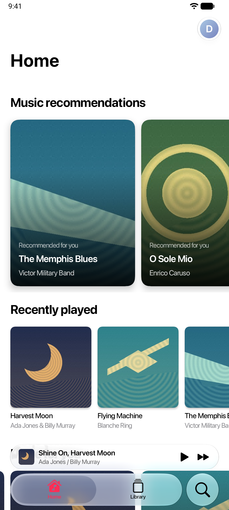
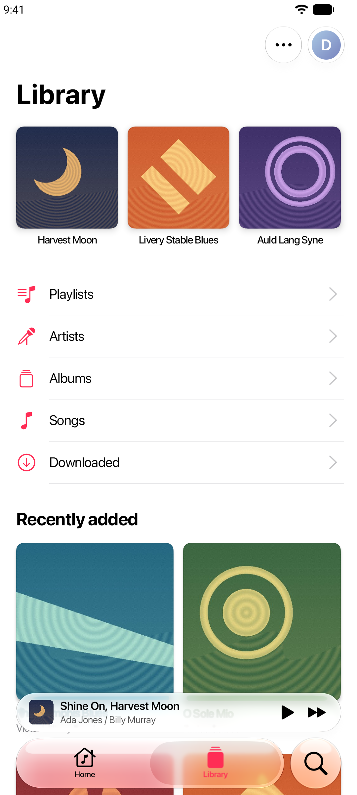
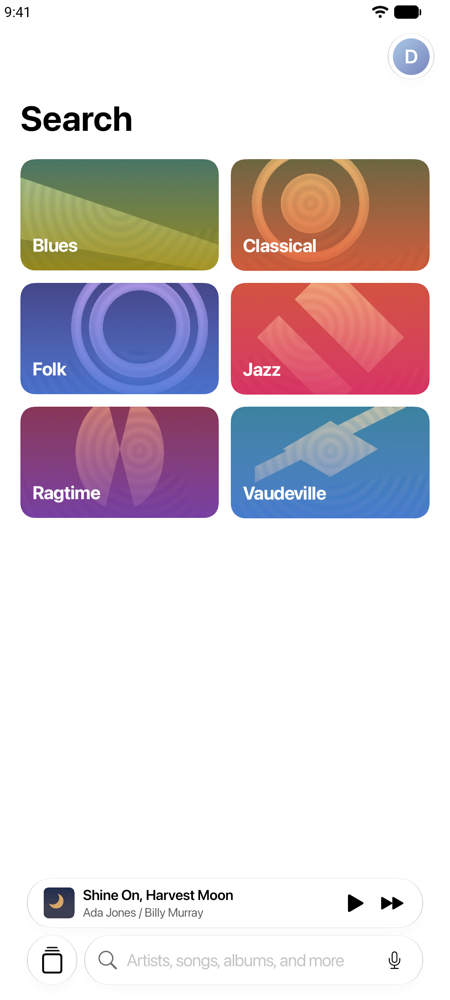
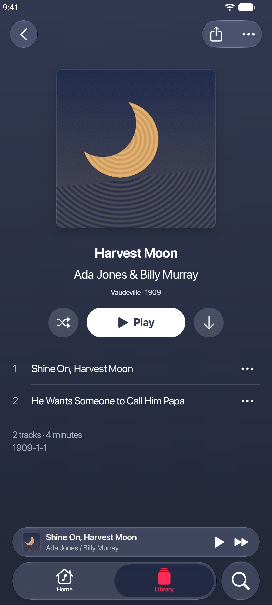
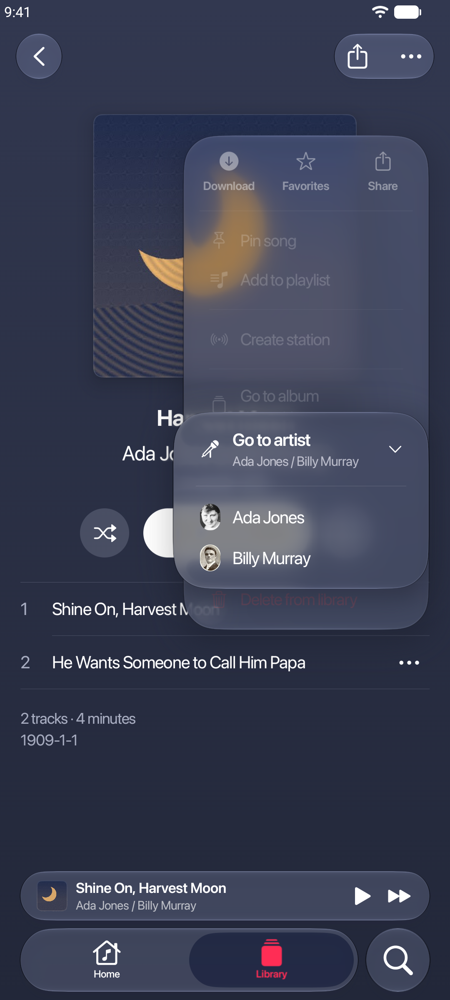
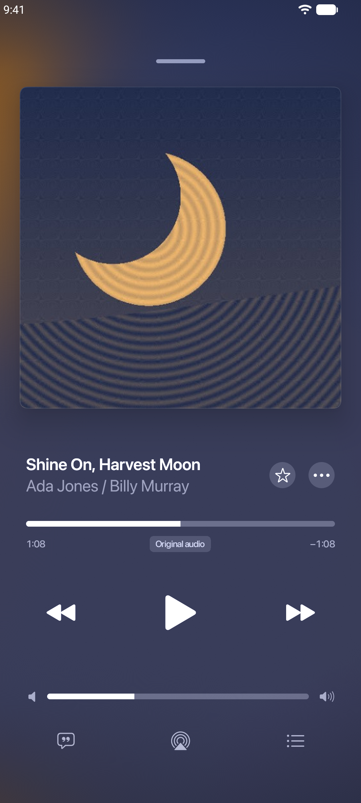
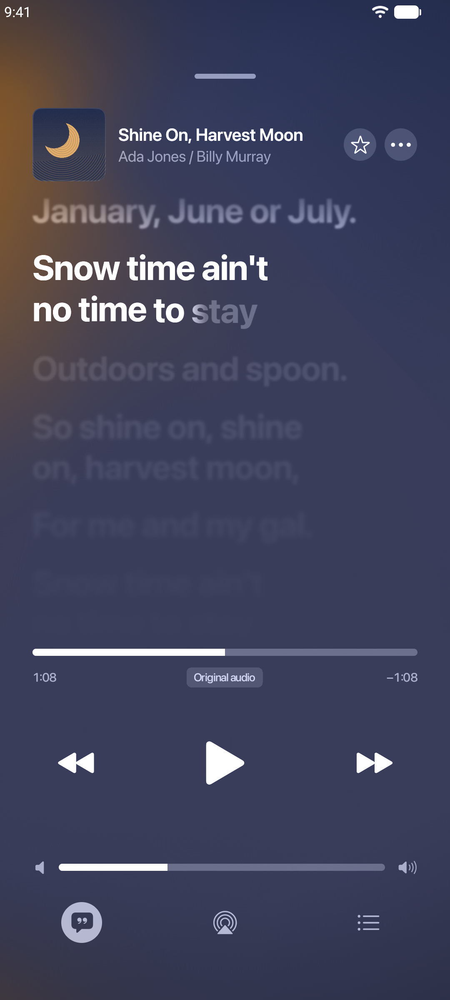
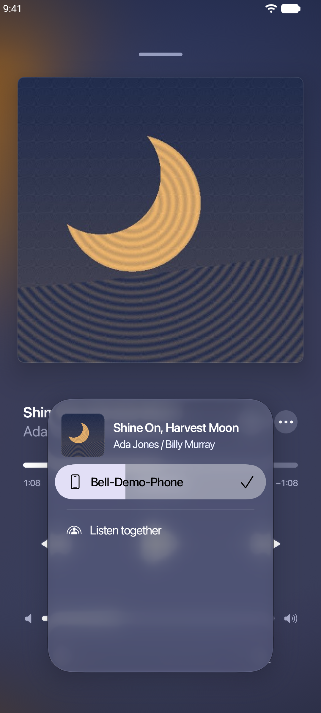
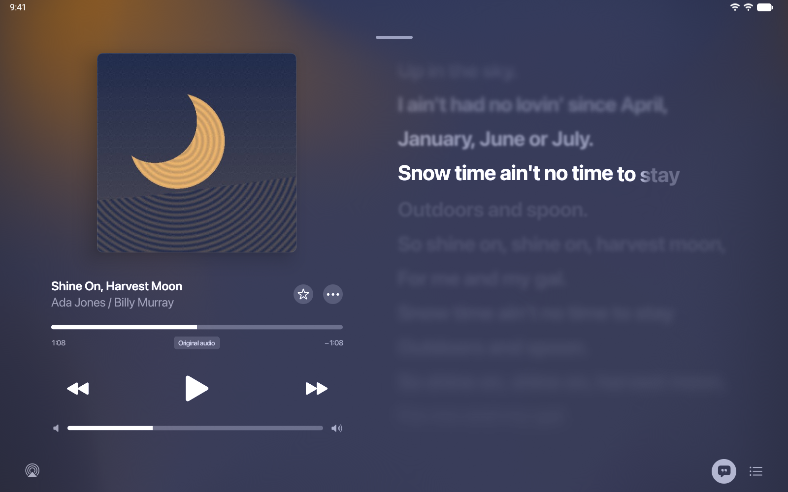

<h1>
    
    Bell
</h1>

The music client, for Jellyfin.

## Screenshots

  
  
  
  

  
  
  
  

## 📄 License

This project is licensed under [Mocha License 1.0](./LICENSE).

You are free to use, study, modify, and redistribute the unmodified software, as well as develop independent extensions. Public distribution of modified releases and monetization of the software require separate authorization.

## 🤝 Contributing

Contributions are welcome! Please see our [Contributing Guidelines](./CONTRIBUTING.md).

Plus, you can help translate this project on [Locus](https://locus.mocharealm.com/p/7b4dcb35025a4126).

If you find this project useful, consider sponsoring its continued development.
